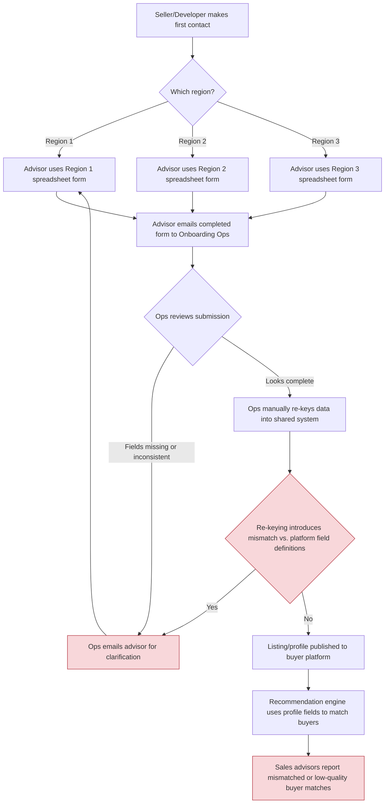
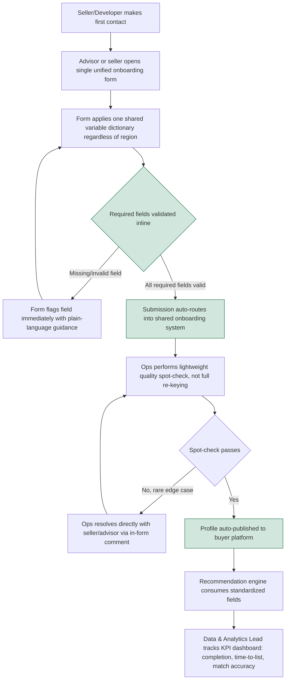

# Seller & Developer Onboarding Redesign — A Business Analysis Case Study

**This is a fictionalized demonstration of business analyst method — requirements → analysis → recommendation — built for a Data/Business Analyst portfolio. It is not a real client engagement.**

All company names, stakeholders, forms, data, and figures in this repository are invented. The fictional company used throughout is **PropCo**, a made-up proptech marketplace. No real organization, client, or individual is represented or referenced.

---

## Why this case study

Seller and developer onboarding is a common failure point for real-estate marketplaces: intake happens across distributed teams, form fields drift out of sync with each other, and the resulting messy data quietly degrades every downstream system that depends on it (in PropCo's case, a buyer-facing recommendation engine). This case study walks through how a business analyst would diagnose that problem and produce a concrete recommendation — using the standard BA toolkit: stakeholder interviews, process mapping, a variable dictionary, user stories, and a KPI framework — rather than jumping straight to a technical fix.

## What's in this repository

| Document | What it covers |
|---|---|
| [`docs/BRD.md`](docs/BRD.md) | Business Requirements Document — problem statement, stakeholders, objectives, scope and out-of-scope. |
| [`docs/process-maps/`](docs/process-maps/) | As-is and to-be process flows (Mermaid `.mmd` source), also embedded below. |
| [`docs/user-stories.md`](docs/user-stories.md) | 12 user stories covering advisors, sellers/developers, Ops, Product, and leadership, each with acceptance criteria. |
| [`docs/kpi-framework.md`](docs/kpi-framework.md) | The KPIs used to measure whether the redesign worked, and why each one was chosen. |

## Method: requirements → analysis → recommendation

1. **Requirements** — [`docs/BRD.md`](docs/BRD.md) captures the problem statement and gathers stakeholder needs (Head of Sales, Product Manager, Onboarding Ops Lead, Sales Advisors, Sellers/Developers, Data & Analytics Lead) into a scoped set of objectives.
2. **Analysis** — the as-is process map below shows where the current fragmented, region-by-region intake process breaks down (highlighted in red); [`docs/user-stories.md`](docs/user-stories.md) translates stakeholder needs into concrete, testable requirements.
3. **Recommendation** — the to-be process map below shows the unified, validated onboarding flow this case study recommends; [`docs/kpi-framework.md`](docs/kpi-framework.md) defines how PropCo would know whether the recommendation actually worked.

---

## As-is process: fragmented regional onboarding

Each region maintains its own spreadsheet-based intake form. Submissions are manually reviewed and re-keyed by Onboarding Ops, which is slow and introduces mismatches against the fields the recommendation engine expects.

Source: [`docs/process-maps/as-is.mmd`](docs/process-maps/as-is.mmd)

## To-be process: unified, validated onboarding

A single onboarding form, backed by one shared variable dictionary, validates required fields inline and routes clean submissions straight into the shared system — sharply reducing manual re-keying and the resulting data-quality issues.

Source: [`docs/process-maps/to-be.mmd`](docs/process-maps/to-be.mmd)

---

## Recommendation summary

Based on the requirements gathered and the as-is/to-be gap shown above, this case study recommends PropCo:

1. Retire the three regional intake spreadsheets in favor of a single unified onboarding form, backed by one shared variable dictionary (one definition per field, used everywhere).
2. Add inline validation on required, recommendation-critical fields so incomplete data can't reach the buyer platform in the first place.
3. Shift Onboarding Ops from full manual re-keying to lightweight exception handling, resolved in-record rather than over email.
4. Track the KPI framework in [`docs/kpi-framework.md`](docs/kpi-framework.md) against a documented as-is baseline, piloting in one region before full rollout.

## Disclaimer

This repository is a fictional, self-contained portfolio artifact created to demonstrate business analysis method. PropCo does not exist. Any resemblance to a real company's specific processes, forms, or terminology is coincidental — no real employer, client, or project data is used or referenced anywhere in this repository.
